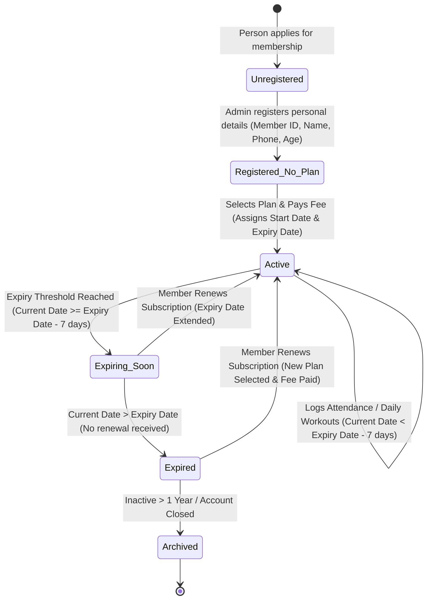
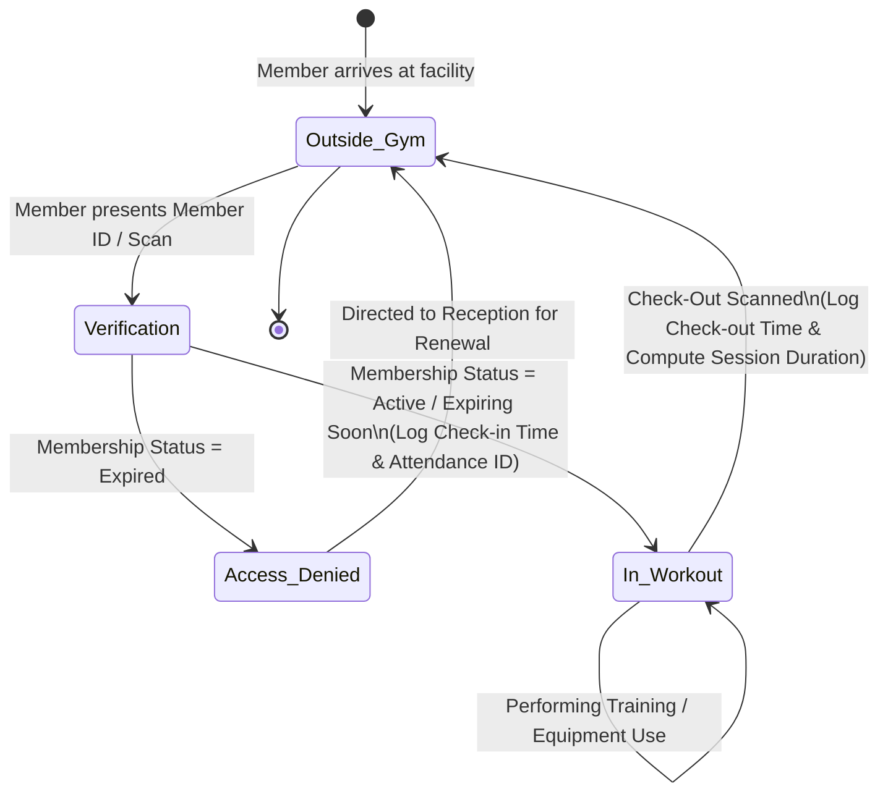

# State Transition Diagram
## Gym Membership Management and Fitness Activity Analysis System (Scenario 27)
**Course:** 25ITT33 – Software Engineering (Unit 3: Software Design)  
**Institution:** Velalar College of Engineering and Technology, Erode - 12  

---

## 1. Description of State Machine
The State Transition Diagram models the dynamic behavior and lifecycle states of two critical system entities:
1. **Membership Lifecycle:** Tracks a member's subscription state from initial registration, through active fitness participation, warning thresholds (expiring soon), expiration, and renewal cycles.
2. **Attendance Session Lifecycle:** Tracks a member's physical presence and check-in/check-out workout sessions within the gym premises.

---

## 2. Membership Lifecycle State Transition Diagram

### Detailed State Descriptions:
1. **Registered_No_Plan:** The member's profile is created in the database, but no active subscription package has been chosen yet.
2. **Active:** The member holds a valid, paid membership plan. They have full access to gym facilities and can check in for daily workouts.
3. **Expiring_Soon:** The membership expiration date is within the alert threshold (7 days or less remaining). Automated renewal alerts are triggered.
4. **Expired:** The expiration date has passed without payment. The member's check-in access is temporarily locked until a renewal fee is recorded.
5. **Archived:** Historical record retained for auditing and reporting, but removed from active rosters.

---

## 3. Attendance Workout Session State Transition Diagram

---

## 4. State Transition Table

| Current State | Trigger Event | Guard Condition | Next State | Resulting Action |
| :--- | :--- | :--- | :--- | :--- |
| **Null** | New Member Application | Valid inputs (Age >= 14, 10-digit phone) | `Registered_No_Plan` | Create member record in database |
| **Registered_No_Plan**| Plan Purchase | Payment confirmed & plan selected | `Active` | Create membership, set start/expiry date |
| **Active** | System Clock Progress | `Days to Expiry <= 7` | `Expiring_Soon` | Flag for renewal alert |
| **Expiring_Soon** | System Clock Progress | `Current Date > Expiry Date` | `Expired` | Lock check-in privileges |
| **Expiring_Soon** | Renewal Payment | Payment received | `Active` | Add plan duration to expiry date |
| **Expired** | Renewal Payment | Payment received | `Active` | Reset start date to today + new duration |
| **Active** | Daily Check-in | Status is Active | `In_Workout` | Insert record into `attendance` table |
| **In_Workout** | Member Check-out | Check-out time > Check-in time | `Outside_Gym` | Update check-out timestamp & compute minutes |
